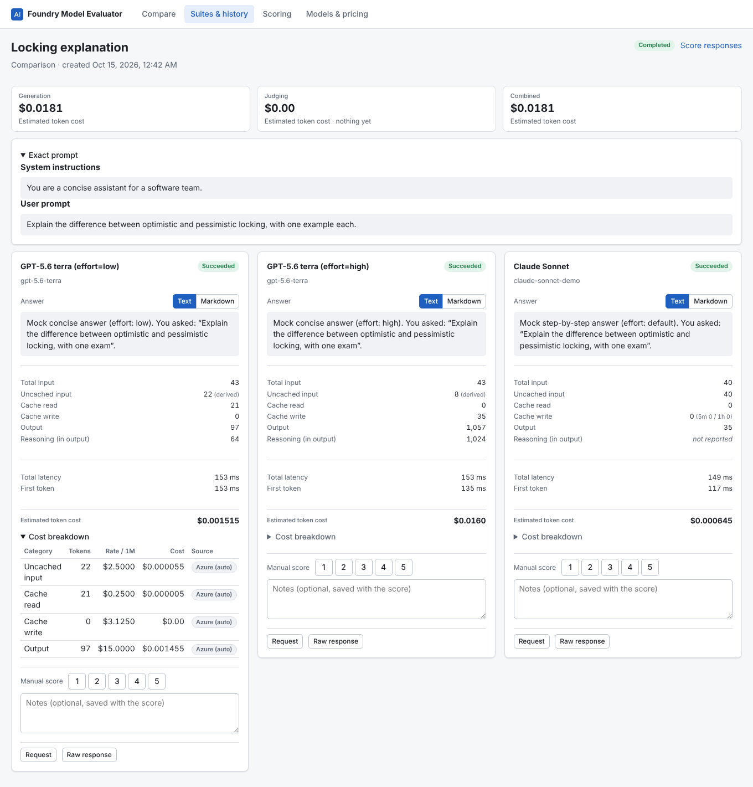
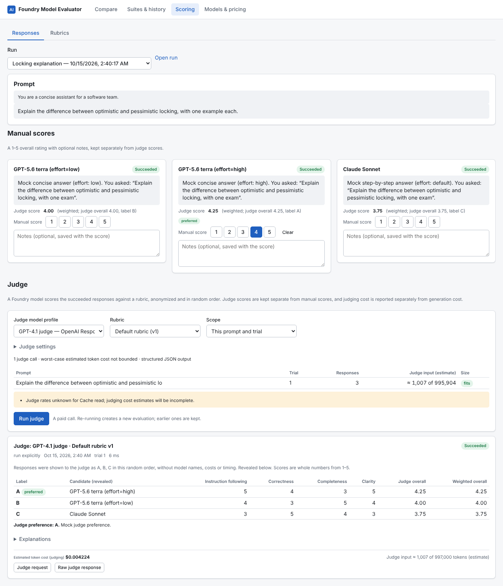
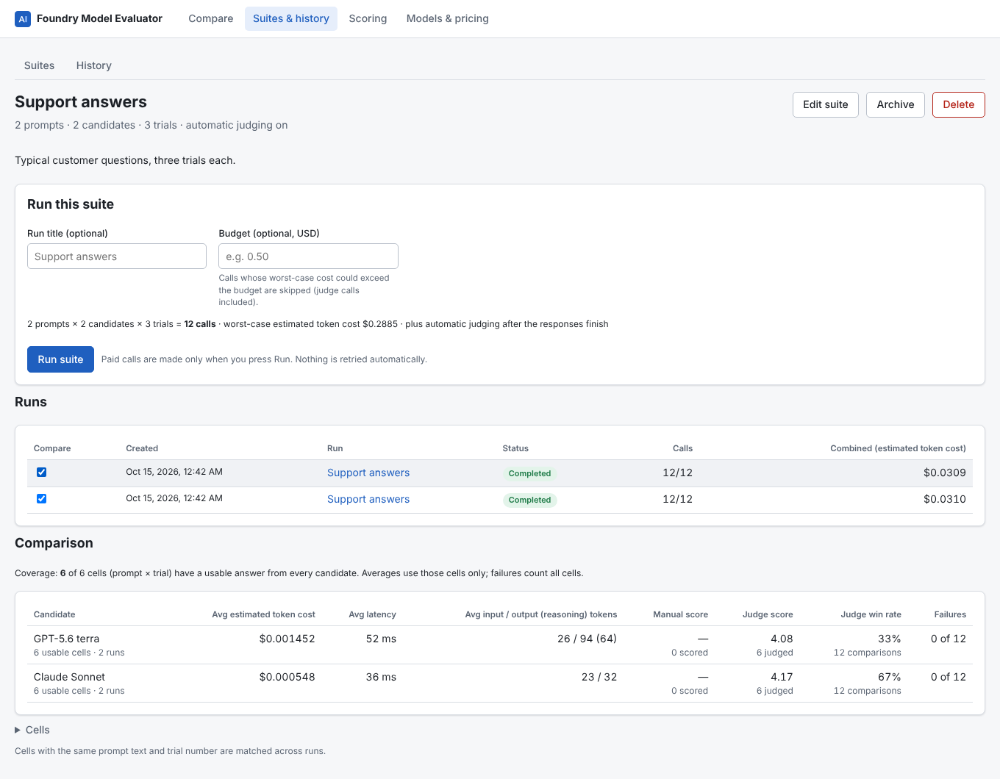
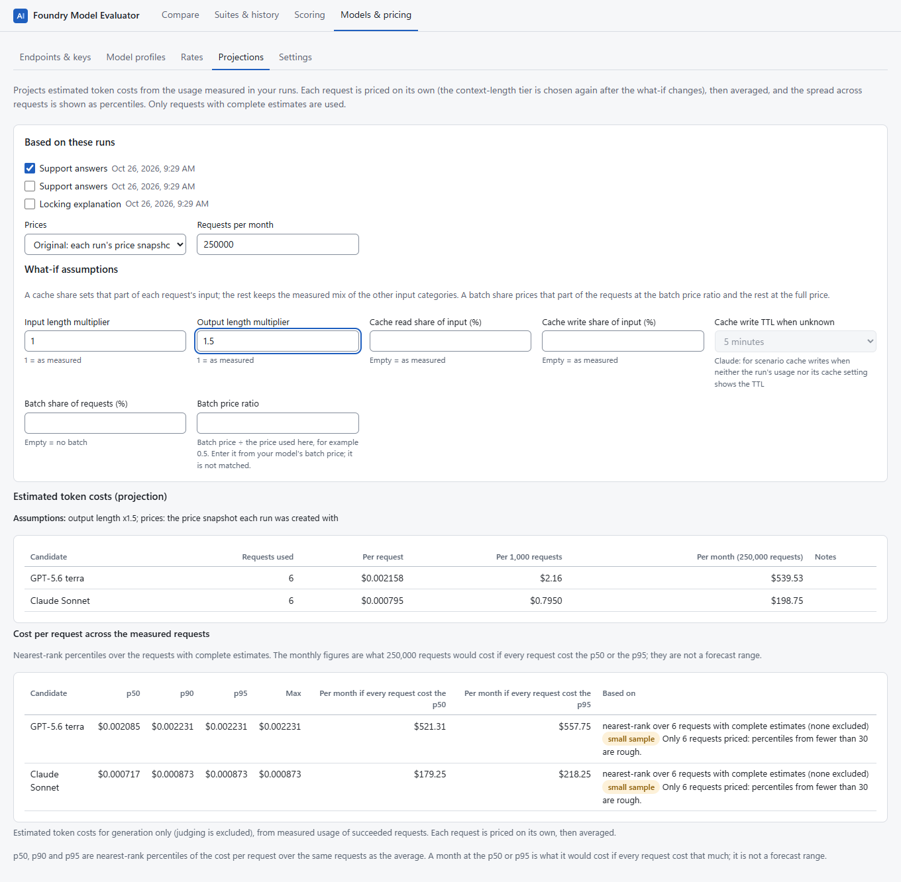
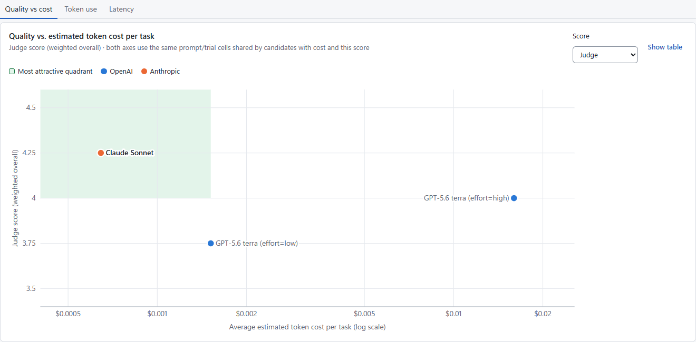
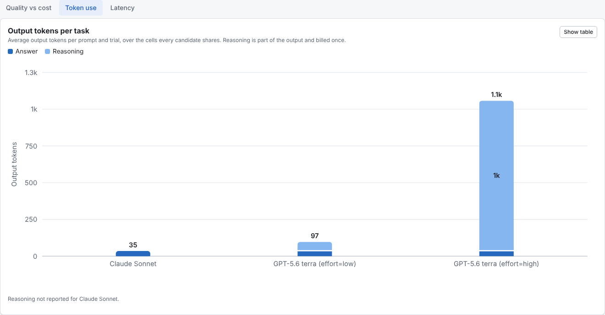

# Foundry Model Evaluator

A personal web app that runs on your own Windows machine. It compares Microsoft Foundry models side by side on answer
quality, token usage, latency and **estimated token cost**.

- **Compare.** Send one prompt to several models, or to one model with different settings (for example low vs high
  reasoning effort), and see the answers next to each other.
- **Suites and history.** Save prompts, models and settings as a suite and run it with repeated trials. You get average
  cost, latency, scores and failure counts over matching prompts and trials, and the coverage is always shown. Each
  average has a 95% range across prompts, and against a baseline candidate each difference says whether it is
  higher, lower, or too close to call. Prompts can be imported from a CSV or JSON-lines file.
- **Reference answers and checks.** Give a prompt a reference answer, which the judge uses to grade correctness, and
  free deterministic checks (contains, does not contain, equals, matches a pattern, number within a tolerance, JSON
  schema).
  Checks run on every answer at no cost, and the pass rate sits next to cost in comparisons and on the quality-vs-cost
  chart, separate from manual and judge scores.
- **Charts.** Runs and suite comparisons are charted: quality against estimated cost per task (log scale, with the
  Pareto frontier and the most attractive quadrant), output tokens split into answer and reasoning, and latency. Every
  chart has a table view. The quality-versus-cost chart uses the same shared prompt/trial cells for both axes
  and its Pareto frontier, with separate paired samples for manual scores, judge scores and checks.
- **Scoring.** Rate answers yourself on a 1–5 scale with notes, or have a Foundry model judge them anonymously against
  a versioned rubric. Manual and judge scores are kept separate. Blind review hides the model names, keys 1–5 score
  the selected answer and N jumps to the next unscored one. **Judge vs. your scores** shows how closely the judge
  agrees with you, so you know whether it can stand in for you on this kind of task. Re-judging adds evidence instead
  of replacing it: comparisons average every evaluation on one judge basis. An opt-in **swap pass** re-judges the
  same answers in reversed order and reports how often the judge's preference follows the position.
- **Models and pricing.** Manage endpoints and API keys, model profiles and rates. Rates come from the Azure Retail
  Prices API (applied only when the match is unambiguous), from manual entries with a source URL, or from labelled
  custom overrides. Projections estimate the cost per request, per 1,000 requests and per month, show the p50, p90
  and p95 cost per request, and can blend in a share of batch requests at a price ratio you enter.

Each response shows the total input, uncached input, cache reads and writes, output and reasoning tokens, the latency
and the estimated token cost. A value the provider did not report shows as **not reported**. An unknown count or rate
makes the estimate **incomplete**: it is shown as a lower bound, never as zero.

| Side-by-side comparison | Anonymized judge and manual scores |
|---|---|
|  |  |
| **Suite comparison with coverage** | **Cost projection with what-if assumptions** |
|  |  |
| **Quality vs. estimated token cost, with the Pareto frontier** | **Output tokens per task: answer and reasoning** |
|  |  |

## Quick start (Windows)

The scripts install nothing. You set up the Python environment and build the web interface yourself, from your own
package sources (for example an Artifactory mirror), and `scripts\check.cmd` tells you what is still missing.

You need:

- **Python 3.12 or newer.** Not the Microsoft Store Python: it redirects the app's writes under `%LOCALAPPDATA%`.
- **Node.js 20.19 or newer**, only to build the web interface.

In the repository folder:

1. Create a virtual environment and install the backend into it in editable mode. Your pip configuration (`pip.ini`
   or `PIP_INDEX_URL`) decides where packages come from.

   ```bat
   python -m venv "%LOCALAPPDATA%\FoundryModelEvaluator\runtime\venv"
   "%LOCALAPPDATA%\FoundryModelEvaluator\runtime\venv\Scripts\python.exe" -m pip install -e backend
   ```

   To use an environment somewhere else, set `FME_VENV` to its folder.
2. Build the web interface. npm uses the registry in your `.npmrc`.

   ```bat
   cd frontend
   npm ci
   npm run build
   cd ..
   ```

3. Check, then start:

   ```bat
   scripts\check.cmd
   scripts\start.cmd
   ```

`check.cmd` lists what is in place and what is needed, with the commands to fix it, and exits with code 1 when
something is needed. `start.cmd` and `foundry-eval.cmd` run the same check first and stop if something is needed.
After pulling new code, run `check.cmd`: it reports when the backend's dependencies changed or the web interface is
older than its sources.

`start.cmd` opens <http://127.0.0.1:8765> in your browser. Press Ctrl+C in the window to stop the app. The `.cmd`
files run the PowerShell scripts without changing your execution policy, and `start.cmd -Port 8766 -NoBrowser` changes
the port and skips opening the browser.

**The exact versions CI tested.** `pip install -e backend` picks versions within the ranges in
`backend/pyproject.toml`. To install the versions pinned in `backend/uv.lock` instead, export them with
[uv](https://docs.astral.sh/uv/), which only reads the lockfile here, then install the export and the backend:

```bat
uv export --frozen --no-dev --no-emit-project --project backend -o "%TEMP%\fme-requirements.txt"
"%LOCALAPPDATA%\FoundryModelEvaluator\runtime\venv\Scripts\python.exe" -m pip install -r "%TEMP%\fme-requirements.txt"
"%LOCALAPPDATA%\FoundryModelEvaluator\runtime\venv\Scripts\python.exe" -m pip install --no-deps -e backend
```

`uv sync --locked` does not work through a mirror: the lockfile records `pypi.org` as the index, so with another index
uv resolves again and refuses.

### First steps

1. In **Models & pricing → Endpoints & keys**, add your Foundry resource URL (for example
   `https://my-resource.services.ai.azure.com`) and its Azure region. Paste the API key and choose **Save key**. Use
   **Verify (free)** to check the key without making a paid call.
2. In **Model profiles**, add a profile for each deployment. Choose the API (OpenAI Responses, Chat Completions or
   Claude Messages) and a capability preset. Then enter the deployment name, and the meter terms used in Azure price
   names (for example `5.6 terra`).
3. In **Rates**, choose **Refresh Azure prices**, then **Match Azure prices**. Claude models are billed through
   Microsoft Marketplace and are not in the Retail Prices API, so enter their rates manually, with the source URL.
4. On **Compare**, write a prompt, add candidates, then choose **Run comparison**. A paid call is made only when you
   choose Run, and nothing is retried automatically.

**Another model or version.** On **Compare** or in a suite, **New variant…** on a candidate saves a copy of its profile
with another model and version, and the candidate switches to it. A variant is a profile of its own: comparisons keep
it apart, and its rates are not copied, so set them or give it the meter terms of its Azure prices. For a local CLI the
version pins a snapshot: model `claude-opus-4-1` with version `20250805` sends `--model claude-opus-4-1-20250805`, and
without a version the model is sent as entered. A Foundry deployment fixes its own version, so there the version is
recorded, not sent. An answer shows the model the provider reported when it says more than what was sent, for example
what an alias such as `opus` resolved to.

## Where things are stored

| What | Where |
|---|---|
| API keys | Windows Credential Manager (service `FoundryModelEvaluator`). Never in files, the database, logs or the browser. |
| Data: database, logs, instance lock | `%LOCALAPPDATA%\FoundryModelEvaluator` |
| Python environment | `%LOCALAPPDATA%\FoundryModelEvaluator\runtime\venv`, or the folder in `FME_VENV`. You create it. |
| Built web interface | `frontend\dist`, else `%LOCALAPPDATA%\FoundryModelEvaluator\runtime\ui`, or the folder in `FME_STATIC_DIR` |

**OneDrive.** The repository may live in a OneDrive-synced folder, but the app's data must not. The app refuses to
start if the data folder is inside the repository or under OneDrive. To use another data folder, set `FME_DATA_DIR` to
a local path outside OneDrive. Keep the virtual environment out of OneDrive too. To keep `node_modules` out of it,
build the web interface from a copy of `frontend` elsewhere and copy its `dist` to `runtime\ui`, or set
`FME_STATIC_DIR` to it. Earlier versions of the scripts also created `runtime\python`, the Python that an environment
they made runs on (keep it while you use that environment), and `runtime\build`, which nothing uses now.

## Command line

`pricing-check` and `smoke` use the data folder directly, so close the app first. `run-suite` is the opposite: it
talks to the running app.

```bat
scripts\foundry-eval.cmd pricing-check --profile "My profile"
scripts\foundry-eval.cmd smoke --profile "Model A" --profile "Model B" --budget 0.05 --judge "Judge model"
scripts\foundry-eval.cmd run-suite --suite "Support answers" --budget 0.50 --run-key build-1234
```

- `pricing-check` is free. It fetches live Azure prices and shows how each profile's meters match, with the reasons.
- `smoke` makes a few tiny paid calls within an explicit budget, optionally followed by a judge evaluation, and prints
  usage and costs. Its results appear in History.
- `run-suite` runs a saved suite in the running app, waits for it, checks gates and prints one JSON document, so a
  new deployment can be checked against a baseline from a script or a CI job. See below.

See [docs/smoke-test.md](docs/smoke-test.md) for a step-by-step live check.

### Suite runs from a script or CI

```bat
scripts\foundry-eval.cmd run-suite --suite "Support answers" --candidate "GPT-5.6 new" --budget 0.50 ^
  --run-key %BUILD_BUILDID% --baseline-run 3f2c9a1e-... --fail-if cost-upper-above=0.40 --tolerance judge=0.25
```

- **The app must be running** (on `FME_PORT`, or pass `--port`). The command sends the same `Origin` and
  `X-FME-Client` headers as the web interface, and is in History like any other run.
- **Spending.** It finds the suite by id or exact name, previews the run for free, and refuses to start without
  `--budget`. Each call reserves its worst case against the budget first, as in the app; calls that no longer fit are
  skipped and count as failed attempts. The command warns when the worst case of the whole run exceeds the budget.
- **`--run-key` never pays twice.** The same suite, candidates and run key always return the same run, so re-running a
  CI job, or a command that timed out or lost its connection, follows and re-checks that run instead of starting a new
  one. Nothing is retried automatically. `--timeout` (default 3600 seconds) only stops the waiting; the run continues.
- **`--candidate`** (repeatable: a candidate's id, label or profile name) runs only those candidates, for example a new
  deployment against a frozen baseline run. Labels stay as in a full run of the suite, and naming every candidate is the
  same run as naming none.
- **Output.** Progress and a summary go to stderr; stdout has only the JSON document: the run, its attempts and
  costs, and every gate with its outcome and reason.

Gates (`--fail-if`, repeatable):

- `failures-above=<n>`: at most *n* failures (the default is 0). Each answer that did not succeed counts, and in a
  judged run so does each prompt and trial that has an answer but no judge result. A prompt and trial without any
  answer is not judged, so it counts once, through its failed answers. An attempt retried in the app counts once,
  through its newest retry. A run whose automatic judging did not start always fails this gate.
- `cost-upper-above=<amount>`: the upper bound of the run's estimated cost (answers and judging) must not exceed the
  amount.
- `incomplete-cost`: every cost estimate must be complete.

**Against a baseline.** `--baseline-run <run id>` compares each new candidate with a candidate of that run
(`--baseline-candidate <key or label>`, needed when it has several) on the judge score, the checks pass rate and the
cost per answer (`--baseline-metrics judge,checks,cost` chooses). It uses the paired differences of the suite
comparison: a metric regresses when the verdict points the bad way (lower score or pass rate, higher cost), that is the
whole 95% interval across prompts is past zero. `--tolerance judge=0.25`, `checks=0.1` or `cost=0.0005` (per answer)
allows that much: the metric regresses only when the end of the interval nearest zero is past the tolerance.
*Cannot tell* passes. A metric that has data but no verdict fails as inconclusive, because missing evidence is not a
pass: fewer than 3 paired prompts, values for only one side, judges that are not comparable, or a bad difference that
is the same on every prompt but on fewer than 6 prompts (the sign test needs 6). A metric neither run has (no judge,
no checks) does not apply, but the gate fails when none of the chosen metrics applies or the comparison fails.

The baseline stays frozen. Before anything is spent, the command refuses a run whose preview shows the baseline
candidate again (the same candidate key: pricing identity and settings), since the comparison would pool the new
answers into the baseline; choose the new candidates with `--candidate`. A profile pointed at a new deployment is a
new candidate and is compared as usual. The command also refuses a suite that shares no prompt with the baseline run,
and warns when it shares only some.

| Exit code | Outcome |
|---|---|
| 0 | Passed. |
| 1 | Gate failed: a cost limit was exceeded, or a metric regressed or was inconclusive against the baseline. |
| 2 | Error before a verdict: bad arguments, the app is not running, the suite was not found, the preview refused the run, or the wait timed out. |
| 3 | Attempts failed: more failed answers or judge results than `failures-above` allows, or automatic judging did not start. |
| 4 | Cost incomplete: a cost gate could not be decided because an estimate is incomplete or pending (an unknown cost is never taken as zero). |

When several apply, 3 comes before 4, and 4 before 1; the JSON lists every gate.

## Export

On a run's page, **Download JSON** and **Download CSV** save the run as a file. The export only reads stored data and
the price snapshots frozen with the run, so it never makes a call to a model.

- **JSON** (`fme.run.v1`) holds the run, prompts, candidates (settings, profile and the rates with their meter,
  source and dates), every attempt (retries included, with usage, latency and cost), manual scores, judge
  evaluations with criterion scores, the run totals, and notes on how to read the costs.
- **CSV** has one row per attempt, with the usage, latency, cost, manual score and latest judge score in separate
  columns. Comparisons average every evaluation on a judge basis instead; the JSON has them all, with `swap_of` on
  swap passes.
- **Costs** are exact decimal strings. An empty cell or `null` means *not reported*, and `cost_status` says why
  (`complete`, `incomplete` with a lower bound, `not_sent`, or `pending`). An unknown cost is never written as 0.
- **Checks.** Each attempt carries its check outcome (`checks_passed` in the CSV: `true`, `false`, `unknown` when a
  check could not be evaluated, `not_checked` when the export ran out of time for pattern checks and downloading
  again continues, or empty when the prompt has no checks); in JSON such a check result has `"not_checked": true`.
  Each prompt says whether it has a reference answer and how many checks; the reference text, the check definitions
  and the per-check details (which can quote the answer) come only with the text included.
- **Retries.** Every attempt is listed. `superseded` is true for an attempt that a later retry replaced
  (`retry_of` names it); only attempts that are not superseded count for their cell.
- **Left out by default:** prompt text, answers, reasoning summaries, provider error messages, stop strings,
  manual-score notes and judge explanations (error messages can quote the prompt or the answer). Tick **Include
  prompt and answer text** to add them. Profiles are exported through an allow-list (no profile notes, meter terms,
  custom path, API version or capabilities). Never included: API keys, the endpoint URL, request bodies and raw
  provider responses.
- **Spreadsheets.** In the CSV, text that starts with `=`, `+`, `-`, `@`, a tab or a carriage return gets a leading
  `'`, so a model's answer or a title cannot run as a formula when you open the file in Excel.
- **Encoding.** The CSV is UTF-8 without a byte-order mark, because it is meant for tools as much as for Excel. In
  Excel, import it (Data > From Text/CSV) and choose UTF-8 as the file origin; opening it directly can garble
  non-ASCII characters.

The same files come from `GET /api/runs/{run_id}/export?format=json|csv&include_text=false`.

## Limits of version 1

- Windows, USD prices, text-only single-turn prompts with optional system instructions, and pay-as-you-go token
  pricing.
- Not included: provisioned throughput (PTU), batch prices (projections take a batch price ratio you enter), images
  and audio, tool calls, importing responses from elsewhere, team hosting, and reconciliation with invoices.
- Costs are **estimates** from token counts and published or entered rates. They are not bills.
- Model capabilities change, so the capability presets are starting points; edit a profile's capabilities when a
  model differs.

## Documentation

- [Token accounting](docs/token-accounting.md): how usage is normalized and priced, with worked examples.
- [Pricing](docs/pricing.md): Azure price matching, manual rates, overrides, snapshots and projections.
- [Security](docs/security.md): the threat model, key handling, the local-only server and paid-call safety.
- [Live smoke test](docs/smoke-test.md): checking real endpoints and prices with a small budget.
- [Implementation plan](docs/implementation-plan.md)

## Development

```bash
cd backend && uv sync && uv run pytest -q && uv run ruff check . && uv run mypy src
cd frontend && npm ci && npm run typecheck && npx vitest run && npm run build && npx playwright test
```

The browser tests start the app on a temporary data folder against a mock Foundry server
(`python -m foundry_eval.devtools.mock_foundry`), so they make no paid calls. For UI work, run
`uv run foundry-eval serve --dev` together with `npm run dev`.

## Licence

[MIT](LICENSE). Copyright (c) 2026 koala-man-64.
